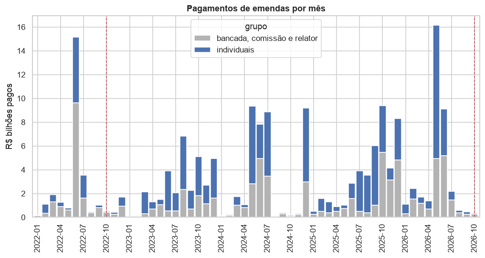

# Eleição Presidencial 2026: análise dos Boletins de Urna

Baixa os Boletins de Urna (BU) do 1º e do 2º turno da eleição presidencial de 2026 no portal de dados abertos do TSE,
converte para Parquet e gera notebooks com gráficos e testes de anomalia:

| Notebook | Abordagem |
|---|---|
| `notebooks/01_analise_neutra.ipynb` | **Neutra**: descreve o resultado e aplica testes forenses de forma simétrica a todos os candidatos, sempre comparando com o que o acaso produziria. |
| `notebooks/02_auditoria_adversarial.ipynb` | **Advogado do diabo**: procura qualquer brecha que pudesse sustentar um pedido de anulação de urnas ou da eleição. Cada achado passa por *hipótese → teste ingênuo → controle → materialidade* (anular todas as seções sinalizadas reverteria a margem?). No fim calcula a "menor brecha": quantas seções precisariam ser anuladas para inverter o resultado e quantas delas têm alguma anomalia técnica. |
| `notebooks/03_comparacao_2022.ipynb` | **Referência**: os mesmos testes aplicados à eleição de 2022, uma simulação de Benford sem fraude e o perfil do eleitorado (idade, escolaridade) das seções que destoam do próprio local de votação. Mostra o que é normal numa eleição brasileira. |
| `notebooks/04_emendas_reeleicao.ipynb` | **Emendas parlamentares**: quanto, de que tipo, quando e para onde foram as emendas de 2023–2026, e se os deputados eleitos em 2022 que destinaram mais emendas, ou as concentraram na própria base, se reelegeram mais em 2026. |

## Destaques

O resumo em linguagem simples, com todas as hipóteses testadas, está em
[`relatorio/hipoteses_e_conclusoes.html`](relatorio/hipoteses_e_conclusoes.html) (baixe e abra no navegador). Alguns
resultados:

**Nenhum boletim de urna com conta errada.** Em 2026 e nos dois turnos de 2022, todas as seções têm votos somando o
comparecimento, e o comparecimento cabe no número de eleitores aptos. Para inverter a ordem do 1º turno de 2026 seria
preciso anular 13.453 seções. Somadas, as seções que algum teste marcou pendem para o 2º colocado: anulá-las aumentaria a
vantagem de quem ficou em primeiro.

**O teste de Benford "reprova" até uma eleição sem fraude.** O 2º dígito dos votos foge da Lei de Benford em 26 das 28
UFs. Mas uma eleição simulada, limpa por construção e com os mesmos tamanhos de seção, reprova o mesmo número. O teste
mede a forma da distribuição dos votos, não fraude.


**As seções que destoam do próprio prédio são as mais novas, com eleitorado mais jovem.** Há cerca de 110 seções que
votam muito diferente das outras do mesmo local, contra ~1 esperada por acaso. O padrão é igual ao de 2022. 57% delas são
a última seção do prédio, que é só 19% de todas as seções. É nessa seção nova que o TSE coloca quem acabou de tirar ou
transferir o título. Seções com 10 pontos ou mais de eleitores de 16 a 24 anos a mais que o resto do prédio são 7% do
total, mas 59% das extremas.


**Em ano de eleição, as emendas são pagas antes de julho.** A lei proíbe essas transferências nos três meses antes da
votação. Em 2026, 90% do ano foi pago no 1º semestre, contra 19% em 2025; em 2024, ano de eleição municipal, 52%.



**Quanto o deputado destina não explica a reeleição, mas para onde destina, sim.** A cota de emendas individuais é igual
por lei, e o valor pago quase não varia. O que se associa a mais votos em 2026 é concentrar as emendas nos municípios
que elegeram o deputado em 2022. A relação vale também comparando deputados do mesmo partido e do mesmo estado. É
associação, não prova de causa, e faltam os gastos de campanha.


As figuras são copiadas dos notebooks por `uv run python scripts/figuras_readme.py`.

## Instalação

Requer [uv](https://docs.astral.sh/uv/). O `uv` cria o ambiente virtual em `.venv` (Python 3.12) e instala as dependências:

```bash
uv sync
```

## Uso

```bash
uv run baixar                     # baixa o BU dos 2 turnos (≈5 GB por turno), conferindo o SHA-512 do TSE
uv run processar                  # filtra o cargo Presidente e gera data/processed/*.parquet (~2 min por turno)
uv run perfil                     # perfil do eleitorado por seção e cadastro de locais de votação (~3 GB)
ELEICOES_ANO=2022 uv run baixar && ELEICOES_ANO=2022 uv run processar   # eleição de 2022, usada como referência
uv run coletar-legislativo        # emendas, deputados federais (TSE 2022/2026) e votações da Câmara (~1,5 GB)
uv run python scripts/gerar_notebooks.py --executar   # gera e executa os notebooks
uv run jupyter lab                # para explorar interativamente
```

Outras opções: `uv run baixar --listar` mostra o que já foi publicado; `--turno 2`, `--uf SP RJ`.

**2º turno:** o TSE publica o CSV do BU cerca de 1 dia depois de cada turno (o do 1º turno saiu em 05/10). Quando
`uv run baixar --listar` mostrar o 2º turno, rode:

```bash
uv run baixar --turno 2 && uv run processar --turno 2 && uv run python scripts/gerar_notebooks.py --executar
```

Os notebooks detectam sozinhos se o 2º turno está disponível. As seções que comparam os dois turnos só rodam quando ele está.

## Emendas parlamentares × deputados federais

`uv run coletar-legislativo` grava em `data/processed/legislativo` as tabelas para cruzar as emendas de 2023–2026 com o
desempenho dos deputados federais em 2022 e 2026:

| Tabela | Fonte | Conteúdo |
|---|---|---|
| `emendas`, `emendas_pagamentos` | Portal da Transparência | valor por emenda; pagamentos por mês e favorecido, com o município (IBGE) |
| `candidatos_depfed`, `votos_depfed_municipio` | TSE | candidatos a deputado federal e votos por município, 2022 e 2026 |
| `camara_*` | Câmara dos Deputados | deputados, votações nominais, orientação das bancadas (inclusive do governo), frentes |
| `ligacao_deputados`, `ligacao_autores_emendas`, `ligacao_municipios` | — | deputado da Câmara ↔ candidato do TSE ↔ autor da emenda; município TSE ↔ IBGE |

Cobertura das ligações: os 513 eleitos em 2022 estão ligados ao cadastro da Câmara, e 507 deles a um autor de emendas.
Os 6 restantes não exerceram o mandato a tempo de apresentar emendas (ministros, cassados). Os autores não ligados são senadores, bancadas e
comissões. Ressalva: parte das emendas com finalidade definida é paga ao Banco do Brasil, em Brasília, como
intermediário (cerca de R$ 20 bi em 2023–2026), e por isso o município de destino não aparece nos pagamentos.

O notebook 04 usa essas tabelas. A tabela por deputado (`eleicoes_2026.emendas.painel_deputados()`) considera as emendas
individuais dos orçamentos de 2024 a 2026 pagas até setembro de 2026: as do orçamento de 2023 foram apresentadas pela
legislatura anterior. A "base eleitoral" de um deputado são os municípios que, somados, deram metade dos votos dele
em 2022. Ainda faltam os gastos de campanha de 2026 e a análise por município (emendas × variação de votos).

## Estrutura

```
src/eleicoes_2026/
  config.py      caminhos, UFs, endpoint CKAN
  download.py    descoberta via API CKAN + download com verificação SHA-512
  perfil.py      perfil do eleitorado por seção (idade, escolaridade) e locais de votação
  legislativo.py emendas parlamentares, deputados federais e votações da Câmara, com as ligações entre as bases
  emendas.py     tabela por deputado (emendas pagas, base eleitoral, governismo, resultado em 2026) para o notebook 04
  process.py     zip → Parquet (DuckDB), tabela longa e tabela por seção
  analise.py     funções estatísticas usadas pelos notebooks
scripts/
  nb_neutro.py, nb_adversarial.py, nb_comparacao.py, nb_emendas.py   conteúdo das células
  gerar_notebooks.py                monta e executa os .ipynb
  figuras_readme.py                 copia dos notebooks os gráficos do README para docs/img
data/            (fora do git) raw/ zips do TSE · interim/ parquet por UF · processed/ tabelas finais · 2022/ referência
notebooks/       notebooks gerados (com saídas)
```

Para alterar um notebook, edite `scripts/nb_*.py` e rode o gerador de novo. Assim os notebooks continuam
reproduzíveis. Edições feitas direto no `.ipynb` são sobrescritas.

## Métodos

- **Consistência aritmética** do BU (aptos = comparecimento + abstenções; votos = comparecimento).
- **Impressão digital de Klimek** (comparecimento × % do candidato), usada para detectar enchimento de urnas.
- **2º dígito de Benford (2BL)** e **último dígito**. O 1º dígito não é usado porque não se aplica a seções de tamanho limitado.
- **Homogeneidade no local de votação**: cada seção é comparada com as outras do mesmo prédio usando um z-score
  quase-binomial, e o número de extremos é comparado com uma simulação beta-binomial sob acaso.
- **Isolation Forest** para triagem multivariada.
- **Efeitos fixos de município** para separar padrões geográficos de padrões da urna (biometria, lote de urnas, comparecimento).
- **Modelo de transição 1º→2º turno** (regressão ecológica com efeito fixo de município).
- **Materialidade**: impacto de anular as seções sinalizadas sobre a margem.
- **Referência histórica**: os mesmos indicadores em 2022 e uma eleição simulada sem fraude, para saber o que é normal.

## Limitações

- O CSV do BU não informa o **modelo da urna**. O notebook adversarial usa a faixa do nº de série e a data de carga
  como aproximação. Para ter o modelo real é preciso processar os logs das urnas ("arquivos transmitidos para
  totalização", também no portal do TSE).
- Os horários do BU estão no fuso local. O fuso de cada município é deduzido da hora de abertura mais comum ali, e o exterior fica de fora.
- Anomalia estatística não prova irregularidade. Ela só indica seções a inspecionar: BU impresso, log da urna, ata da mesa.
