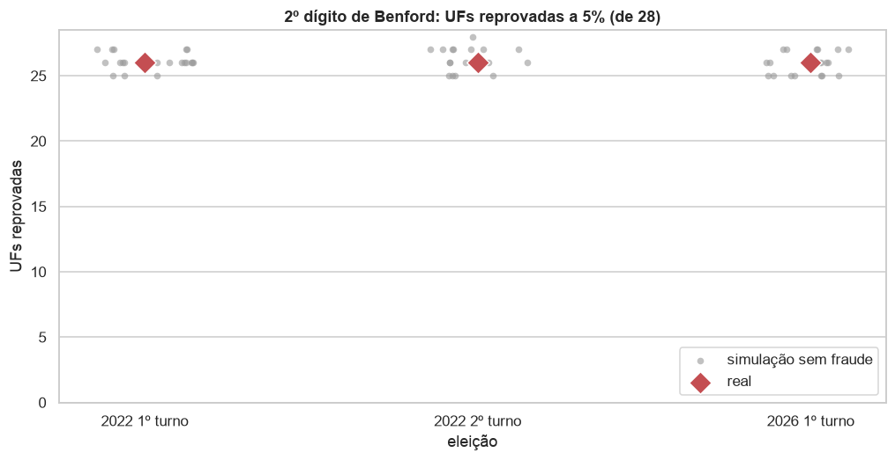
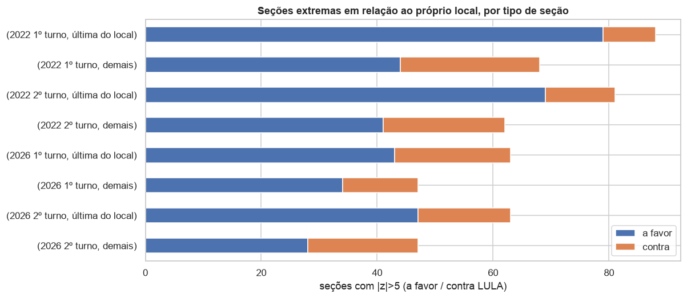
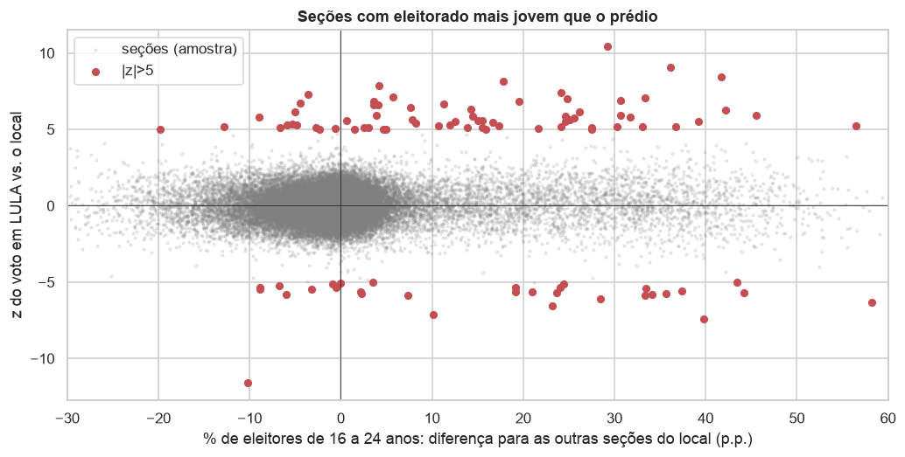
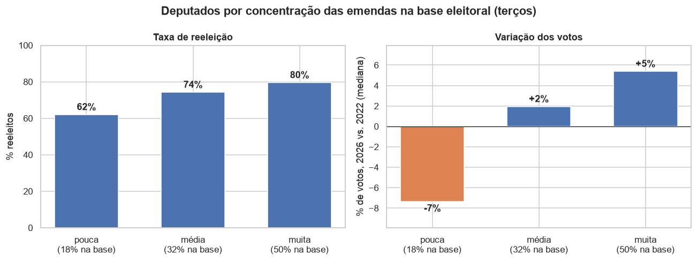

# Eleição Presidencial 2026: análise dos Boletins de Urna

Baixa os Boletins de Urna (BU) do 1º e do 2º turno da eleição presidencial de 2026 no portal de dados abertos do TSE,
converte para Parquet e gera notebooks com gráficos e testes de anomalia:

| Notebook | Abordagem |
|---|---|
| `notebooks/01_analise_neutra.ipynb` | **Neutra**: descreve o resultado e aplica testes forenses de forma simétrica a todos os candidatos, sempre comparando com o que o acaso produziria. |
| `notebooks/02_auditoria_adversarial.ipynb` | **Advogado do diabo**: procura qualquer brecha que pudesse sustentar um pedido de anulação de urnas ou da eleição. Cada achado passa por *hipótese → teste ingênuo → controle → materialidade* (anular todas as seções sinalizadas reverteria a margem?). No fim calcula a "menor brecha": quantas seções precisariam ser anuladas para inverter o resultado e quantas delas têm alguma anomalia técnica. |
| `notebooks/03_comparacao_2022.ipynb` | **Referência**: os mesmos testes aplicados à eleição de 2022, uma simulação de Benford sem fraude e o perfil do eleitorado (idade, escolaridade) das seções que destoam do próprio local de votação. Mostra o que é normal numa eleição brasileira. Também confere argumentos que circularam depois do 2º turno. |
| `notebooks/04_emendas_reeleicao.ipynb` | **Emendas parlamentares**: quanto, de que tipo, quando e para onde foram as emendas de 2023–2026, e se os deputados eleitos em 2022 que destinaram mais emendas, ou as concentraram na própria base, se reelegeram mais em 2026. |

## Destaques

**[Leia o relatório em linguagem simples](https://marcospflbarreto.github.io/eleicoes-2026/)**, com todas as hipóteses
testadas e o que cada uma concluiu (fonte em [`docs/index.html`](docs/index.html)). Os números são mostrados com o
teste que os põe em contexto; anomalia estatística indica onde olhar, não prova irregularidade. Alguns resultados:

**Nenhum boletim de urna com conta errada.** Nos dois turnos de 2026 e nos dois de 2022, todas as seções têm votos
somando o comparecimento, e o comparecimento cabe no número de eleitores aptos. No 2º turno de 2026, Lula venceu por
4.430.191 votos (51,8% dos válidos); para inverter o resultado seria preciso anular 23.770 seções. No 1º turno, Flávio
Bolsonaro ficou 2.224.965 votos à frente, e seriam 13.453 seções.

**As seções que os testes marcam pendem para Lula nos dois turnos, por um motivo só.** No 1º turno, anular todas as
seções marcadas por algum teste aumentaria a vantagem de quem ficou em primeiro. No 2º, elas dão a Lula, o vencedor, um
saldo de 997 mil votos (22,5% da diferença). Quase tudo vem das 16.142 seções agregadas, que recebem os eleitores de
outra seção pequena: são as mesmas nos dois turnos e votam mais em Lula nos dois. Sem elas, o que sobra vale 3,8% da
diferença. As 446 seções que o modelo entre turnos aponta como "fora da previsão" votaram quase igual nos dois turnos
(90% mudaram menos de 5 pontos): quem erra é o modelo, que se apoia na média do município.

**Os argumentos que circularam depois do 2º turno têm os números certos e a leitura errada.** As 3.042 seções em que
Flávio fez até 10 votos são pequenas, rurais, no Nordeste e na Amazônia, e já votavam assim no 1º turno; em 2022 eram
4.118. "Lula cresceu em todos os estados" mede a fatia entre os dois finalistas, que soma 100%: em 2022 foi Bolsonaro
quem cresceu nos 28. No Rio, Flávio ficou parado porque cerca de 5% dos eleitores dele não voltaram a votar, não porque
Lula levou 70% da direita (a estimativa fica entre um terço e metade). Detalhes no
[relatório](https://marcospflbarreto.github.io/eleicoes-2026/#perguntas) e na seção 5 do notebook 03.

**O teste de Benford "reprova" até uma eleição sem fraude.** O 2º dígito dos votos foge da Lei de Benford em 26 das 28
UFs no 1º turno de 2026 e em 25 no 2º. Mas uma eleição simulada, limpa por construção e com os mesmos tamanhos de seção, reprova o mesmo número. O teste
mede a forma da distribuição dos votos, não fraude.



**O modelo da urna não muda o voto.** As urnas de 2026 são de quatro modelos, de 2013 a 2022. Na média nacional, o voto
no 1º colocado varia 2,3 pontos entre modelos. Comparando só urnas do mesmo prédio, a diferença cai para 0,15 ponto: ela
vem de onde cada modelo foi instalado, não do modelo. No 2º turno, 2,4 e 0,17 pontos.


**As seções que destoam do próprio prédio são as mais novas, com eleitorado mais jovem.** Em cada turno de 2026 há 110
seções que votam muito diferente das outras do mesmo local, contra ~1 esperada por acaso. O padrão é igual ao de 2022. 57% delas são
a última seção do prédio, que é só 19% de todas as seções. É nessa seção nova que o TSE coloca quem acabou de tirar ou
transferir o título. Seções com 10 pontos ou mais de eleitores de 16 a 24 anos a mais que o resto do prédio são 7% do
total, mas 59% das extremas.





**Em ano de eleição, as emendas são pagas antes de julho.** A lei proíbe essas transferências nos três meses antes da
votação. Em 2026, 90% do ano foi pago no 1º semestre, contra 19% em 2025; em 2024, ano de eleição municipal, 52%.


**Quanto o deputado destina não explica a reeleição, mas para onde destina, sim.** A cota de emendas individuais é igual
por lei, e o valor pago quase não varia. O que se associa a mais votos em 2026 é concentrar as emendas nos municípios
que elegeram o deputado em 2022. A relação vale também comparando deputados do mesmo partido e do mesmo estado. O
dinheiro de campanha pesa mais na reeleição (cada R$ 1 milhão a mais de receita, cerca de 11 pontos de chance), mas não
anda junto com a concentração na base: controlar pelas receitas não muda essa relação. É associação, não prova de causa.



As figuras são copiadas dos notebooks por `uv run python scripts/figuras_readme.py`.

## Instalação

Requer [uv](https://docs.astral.sh/uv/). O `uv` cria o ambiente virtual em `.venv` (Python 3.12) e instala as dependências:

```bash
uv sync
```

## Uso

```bash
uv run baixar                     # baixa o BU dos 2 turnos (≈5 GB por turno), conferindo o SHA-512 do TSE
uv run processar                  # filtra o cargo Presidente e gera data/processed/*.parquet (~2 min por turno)
uv run perfil                     # perfil do eleitorado por seção e cadastro de locais de votação (~3 GB)
ELEICOES_ANO=2022 uv run baixar && ELEICOES_ANO=2022 uv run processar   # eleição de 2022, usada como referência
uv run coletar-legislativo        # emendas, deputados federais (TSE 2022/2026), receitas de campanha e votações da Câmara (~2 GB)
uv run modelo-urna                # modelo da urna de cada seção (DataUrnas-BR), conferido com o BU
uv run python scripts/gerar_notebooks.py --executar   # gera e executa os notebooks
uv run jupyter lab                # para explorar interativamente
```

Outras opções: `uv run baixar --listar` mostra o que já foi publicado; `--turno 2`, `--uf SP RJ`.

**2º turno:** o TSE publica o CSV do BU cerca de 1 dia depois de cada turno (o do 1º turno saiu em 05/10, o do 2º em
26/10). `scripts/atualizar_2t.sh` confere se as 28 UFs estão no portal e, se estiverem, baixa, processa e reexecuta os
notebooks:

```bash
uv run baixar --turno 2 && uv run processar --turno 2 && uv run python scripts/gerar_notebooks.py --executar
```

Os notebooks detectam sozinhos se o 2º turno está disponível. As seções que comparam os dois turnos só rodam quando ele está.
O download lê o pacote do portal direto (`package_show`): o índice de busca do portal demorou dias para mostrar o 2º turno.

## Emendas parlamentares × deputados federais

`uv run coletar-legislativo` grava em `data/processed/legislativo` as tabelas para cruzar as emendas de 2023–2026 com o
desempenho dos deputados federais em 2022 e 2026:

| Tabela | Fonte | Conteúdo |
|---|---|---|
| `emendas`, `emendas_pagamentos` | Portal da Transparência | valor por emenda; pagamentos por mês e favorecido, com o município (IBGE) |
| `candidatos_depfed`, `votos_depfed_municipio` | TSE | candidatos a deputado federal e votos por município, 2022 e 2026 |
| `receitas_depfed` | TSE | receitas de campanha por candidato a deputado federal em 2026, por origem (FEFC, fundo partidário, pessoas físicas, próprias) |
| `camara_*` | Câmara dos Deputados | deputados, votações nominais, orientação das bancadas (inclusive do governo), frentes |
| `ligacao_deputados`, `ligacao_autores_emendas`, `ligacao_municipios` | — | deputado da Câmara ↔ candidato do TSE ↔ autor da emenda; município TSE ↔ IBGE |

Cobertura das ligações: os 513 eleitos em 2022 estão ligados ao cadastro da Câmara, e 507 deles a um autor de emendas.
Os 6 restantes não exerceram o mandato a tempo de apresentar emendas (ministros, cassados). Os autores não ligados são senadores, bancadas e
comissões. Ressalva: parte das emendas com finalidade definida é paga ao Banco do Brasil, em Brasília, como
intermediário (cerca de R$ 20 bi em 2023–2026), e por isso o município de destino não aparece nos pagamentos.

O notebook 04 usa essas tabelas. A tabela por deputado (`eleicoes_2026.emendas.painel_deputados()`) considera as emendas
individuais dos orçamentos de 2024 a 2026 pagas até setembro de 2026: as do orçamento de 2023 foram apresentadas pela
legislatura anterior. A "base eleitoral" de um deputado são os municípios que, somados, deram metade dos votos dele
em 2022. As receitas de campanha são as declaradas até agora: a prestação de contas final vence 30 dias depois da eleição,
e o TSE atualiza o arquivo todo dia (apague `data/raw/tse/prestacao_de_contas_eleitorais_candidatos_2026.zip` e rode
`uv run coletar-legislativo --etapas contas` para atualizar). Ainda falta a análise por município (emendas × variação de
votos).

## Estrutura

```
src/eleicoes_2026/
  config.py      caminhos, UFs, endpoint CKAN
  download.py    descoberta via API CKAN + download com verificação SHA-512
  perfil.py      perfil do eleitorado por seção (idade, escolaridade) e locais de votação
  legislativo.py emendas parlamentares, deputados federais e votações da Câmara, com as ligações entre as bases
  modelo_urna.py modelo da urna por seção (DataUrnas-BR), conferido com o BU
  emendas.py     tabela por deputado (emendas pagas, base eleitoral, governismo, resultado em 2026) para o notebook 04
  process.py     zip → Parquet (DuckDB), tabela longa e tabela por seção
  analise.py     funções estatísticas usadas pelos notebooks
scripts/
  nb_neutro.py, nb_adversarial.py, nb_comparacao.py, nb_emendas.py   conteúdo das células
  gerar_notebooks.py                monta e executa os .ipynb
  figuras_readme.py                 copia dos notebooks os gráficos do README para docs/img
data/            (fora do git) raw/ zips do TSE · interim/ parquet por UF · processed/ tabelas finais · 2022/ referência
notebooks/       notebooks gerados (com saídas)
```

Para alterar um notebook, edite `scripts/nb_*.py` e rode o gerador de novo. Assim os notebooks continuam
reproduzíveis. Edições feitas direto no `.ipynb` são sobrescritas.

## Métodos

- **Consistência aritmética** do BU (aptos = comparecimento + abstenções; votos = comparecimento).
- **Impressão digital de Klimek** (comparecimento × % do candidato), usada para detectar enchimento de urnas.
- **2º dígito de Benford (2BL)** e **último dígito**. O 1º dígito não é usado porque não se aplica a seções de tamanho limitado.
- **Homogeneidade no local de votação**: cada seção é comparada com as outras do mesmo prédio usando um z-score
  quase-binomial, e o número de extremos é comparado com uma simulação beta-binomial sob acaso.
- **Isolation Forest** para triagem multivariada.
- **Efeitos fixos de município** para separar padrões geográficos de padrões da urna (biometria, lote de urnas, comparecimento).
- **Modelo de transição 1º→2º turno** (regressão ecológica com efeito fixo de município).
- **Materialidade**: impacto de anular as seções sinalizadas sobre a margem.
- **Referência histórica**: os mesmos indicadores em 2022 e uma eleição simulada sem fraude, para saber o que é normal.

## Limitações

- O CSV do BU não informa o **modelo da urna**. Ele vem do projeto [DataUrnas-BR](https://github.com/alissonlinneker/DataUrnas-BR),
  que decodificou os BUs binários e conferiu o modelo com o certificado de cada urna. `uv run modelo-urna` usa uma versão
  fixa dessa tabela e só a grava se seção e número da urna baterem com o BU do TSE (bateram nas 499.206 seções do 1º
  turno). No 2º turno o modelo vem do número da urna.
- Os horários do BU estão no fuso local. O fuso de cada município é deduzido da hora de abertura mais comum ali, e o exterior fica de fora.
- Anomalia estatística não prova irregularidade. Ela só indica seções a inspecionar: BU impresso, log da urna, ata da mesa.
